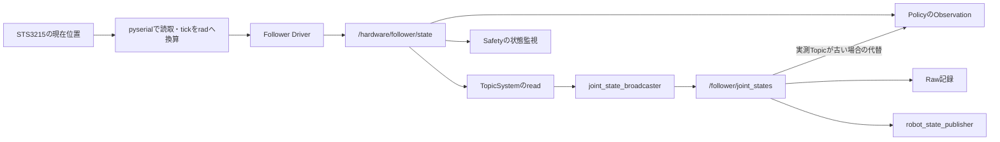
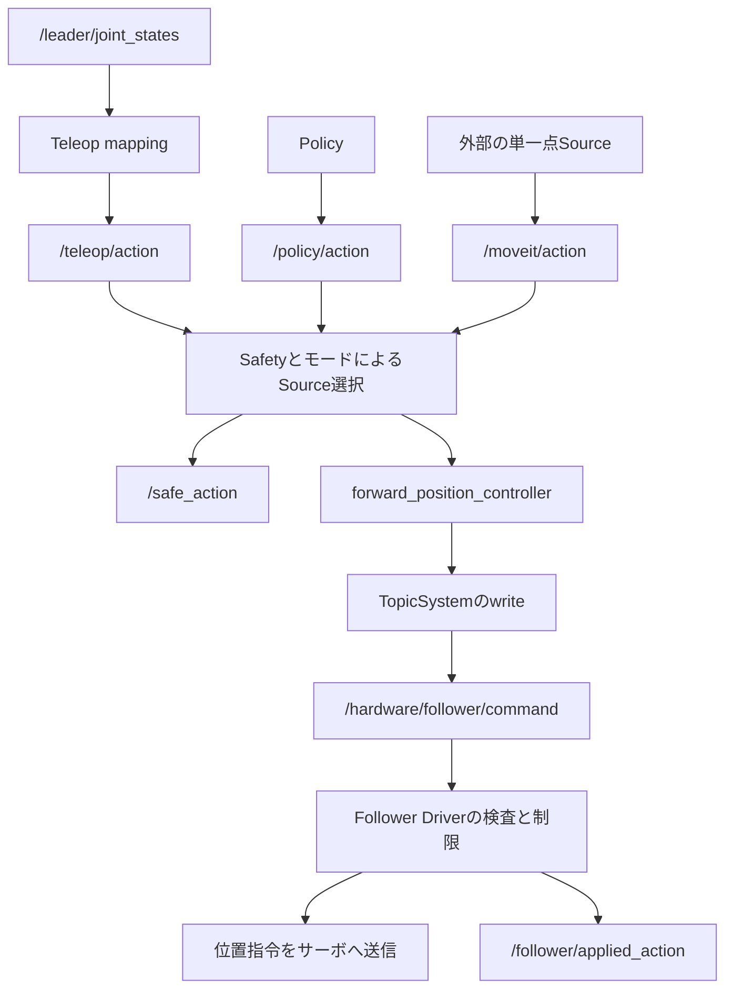

# ROS 2構成と、データ・指令の通り道

理由や仕組みから学ぶ場合は、[観測と指令から読む全体構成の教材](learning/01-loop-and-environment.ja.md)を併読できます。

Leaderを動かしたとき、Followerへ届くまでに複数の処理が入ります。この分割によって、同じFollowerへ人の操作とAIの指令を切り替えて送れます。新しいロボットへ移す場合も、上位の記録と学習を保ちながら通信処理を置き換えられます。

操作は[README](../README.md)、用語は[ROS 2基礎](learning/02-ros-communication.ja.md)を参照します。この章は現行コードの構成を説明します。

## 1. PCとコンテナの役割

| 場所 | 担当 | この配置にする理由 |
|---|---|---|
| Linuxホスト | USB機器、GPUドライバー、Docker、共有ファイル | 実物へアクセスする基盤を置く |
| 1つのDockerコンテナ | MATE GUI、ROS 2 Jazzy、制御、カメラ、記録、変換、学習、推論 | GUIから直接同じパス・ROS・Pythonを使う |
| 操作用PCなどの操作端末 | ブラウザ、SSHトンネル、任意のVS Code・Foxglove | GUIへ接続する入口にする |

GUIとRuntimeは同じコンテナ内のROSとPythonを使い、専用bridgeネットワークで通信します。ブラウザとFoxgloveだけをホストの127.0.0.1へ転送します。Policyは時刻の近い状態・画像を短い履歴から選び、許容差と鮮度を検査します。

Runtimeと学習は、GPU・CPU・メモリー・ストレージを奪い合うため、共通ロックで同時実行を避けます。ContainerがRunningでも、Runtimeが起動中とは限りません。Composeの常駐処理はMATE・Xvnc・websockifyです。GUI内のscripts/runtime.shが実際のROS Launchを起動します。デスクトップとROSはdevユーザーで動き、USB・カメラ用の数値グループとデバイスアクセスをComposeで渡します。

## 2. 9つのPackageと起動する処理

| Package | 主な内容 | 読むコード |
|---|---|---|
| `so101_core` | 通信、校正、単位換算、制御計算、同期、Dataset、ACT | `so101_core/*.py` |
| `so101_msgs` | 独自MessageとServiceの型 | `msg/`、`srv/` |
| `so101_description` | URDF/Xacro、近似MuJoCoモデル | `urdf/`、`mujoco/` |
| `so101_hardware` | Leader/Follower Driver、Camera、C++ Hardware Plugin | `drivers.py`、`camera.py`、`topic_system.cpp` |
| `so101_teleop` | LeaderからFollowerへの関節対応 | `node.py` |
| `so101_safety` | 指令選択、モード、制限、停止 | `node.py` |
| `so101_dataset` | Episode管理とRaw記録 | `episode.py`、`recorder.py` |
| `so101_policy` | 観測の構成、推論worker、指令公開 | `node.py` |
| `so101_bringup` | Node群のLaunchとシステム診断 | `runtime.launch.py`、`diagnostics.py` |

外部のROS Packageとしてcontroller_manager、joint_state_broadcaster、position_controllers、robot_state_publisher、foxglove_bridgeを使います。標準のLeRobot Profileはforward_position_controller、旧bounded Profileはjoint_trajectory_controllerを起動します。サーボ固有の処理とプロジェクト固有の記録・学習は、このリポジトリのコードで行います。

## 3. 状態の経路

Safetyは `/hardware/follower/state` を読みます。Policyは設定の `measurement_state_topic` を優先し、現在の値は同じ実測Topicです。この更新が途絶えた場合の代替として `/follower/joint_states` も購読します。Dataset変換も設定の実測Topicを優先し、記録には両方を含めます。元はサーボ位置であり、Controller内部の目標を実測として出す構成ではありません。

Leader Driverも実機ではサーボ位置を読みます。公開する関節名には `leader_` を付け、Followerの関節名と区別します。mockではLeaderの値を正弦波で生成し、USBサーボを読みません。

## 4. 指令の経路

Safetyは `/selected_action` に選択結果、`/safe_action` にProfileに応じた検査・処理後の指令を出します。同じ指令を `/controller_input` とControllerへ渡します。図は標準のLeRobot Profileです。この場合、Controllerの入力Topicは `/forward_position_controller/commands`、型はFloat64MultiArrayです。記録用の安全指令は名前・時刻付きのJointTrajectoryとして残します。

標準では回転関節へ独自の速度・加速度制限を追加しません。Driverの `max_relative_target` も、nullなら追加の目標差制限を行いません。旧bounded Profileは異なる制限とJoint Trajectory Controllerを使います。Driverは送信に成功した後、`/follower/applied_action` を公開します。

そのため、Teleopの目標、Safetyの出力、実際に送信した目標は異なる場合があります。学習では最後のapplied_actionを教師にし、実測位置をStateとして別に保存します。送信成功は物理的な到達の確認ではありません。

## 5. ros2_controlと通信処理の接続

`TopicSystem` はC++のSystemInterfaceです。Controller Managerへ6関節のposition state/command interfaceを公開します。ROS Topicを通してPython Driverと接続するため、サーボ通信コードをPythonで管理できます。

Controller Managerの周期では、概念的にread → Controller更新 → writeを繰り返します。TopicSystemのreadは新しい状態を取得し、writeは現在の指令を渡します。USBの読み書きそのものはPython Driver側です。

writeからDDSの送信待ちで制御が止まりにくいよう、RealtimePublisherを使って送信を別スレッドへ移しています。送信側が使用中ならその周期の公開を見送り、次の周期で新しい指令を渡します。すべての周期の公開を保証する構成ではないため、鮮度検査とWatchdog、実測の周期確認を組み合わせます。

### 通信で検査する値と、角度への換算

`so101_core/feetech.py` は、STS3215のprotocol-0 Packetをpyserialで送受信します。受信したPacketのチェックサム、応答ID、長さ、エラービット、応答期限を検査します。必要なサーボの応答がそろわない場合は、不完全な状態を正常なJointStateとして出しません。

同期書込みにはサーボごとのACKがありません。`applied_action` の送信成功は、通信APIへ渡せた結果であり、各サーボの受領や物理的到達を個別に確認した結果ではありません。目標と実測を分けて記録する理由の一つです。

5つの回転関節の換算は `(tick − (range_min + range_max)/2) × 2π/4095`、グリッパーは `closed_rad + (tick − range_min) × 2π/4095` です。グリッパーは閉位置を基準にします。原点・範囲の測定とID照合は[校正手順](calibration.ja.md)で行い、LeaderとFollowerの開閉幅の違いはTeleopのscale/offsetで対応づけます。

Probeは接続と切断を含め、サーボレジスターを書き換えない読取り経路です。実機Runtimeは起動時に設定も行うため、読取り確認にRuntimeを代用しません。

Composeは `RMW_FASTRTPS_PUBLICATION_MODE=ASYNCHRONOUS` を既定とします。非同期DDSとRealtimePublisherは、制御処理へ送信待ちを持ち込む経路を減らす対策です。Reliableのキュー満杯、USB待ち、Pythonの実行遅延まで保証するものではないため、周期と最大遅延を実測します。

## 6. 指令停止の責任を分ける

| 場所 | 監視すること | 停止時の扱い |
|---|---|---|
| Teleop | LeaderのHeaderと受信の鮮度 | 新しい指令を公開しない |
| Safety | 状態・指令・周期・Mode・物理停止通知 | FAULT/ESTOPを保持し、Enableを解除 |
| C++ Hardware Plugin | Safe heartbeat、Enable、State | 古い指令で更新を続けない |
| Follower Driver | CommandとEnableの期限、入出力異常 | Torque OFFを試みる |
| 現場の停止回路 | 電源停止条件 | PC/ROS/USBに依存せず給電停止 |

ROSで停止を通知しても、通信断ではサーボへTorque OFFが届かない場合があります。物理電源停止はソフトウェア通知と別に必要です。停止理由はSafetyのERRORログに出し、停止中も約1秒ごとに `/diagnostics` へ公開します。停止後に接続した監視端末も、Safetyのmessageから原因を確認できます。[制御と停止の詳細](control.ja.md)を参照します。

## 7. カメラと学習入力の構成

Top、Side、Armの3カメラはそれぞれ別Nodeで取得します。H.264 ProfileではカメラごとにNVENC圧縮し、RecorderとFoxgloveが同じ映像を使います。必要な場合は圧縮前のRGBをPolicyへ配信します。Raw ProfileではRGB記録とJPEG Previewを分けます。現在のObservationはTopとArmで、Sideを記録していてもモデル入力には自動で入りません。

画像前処理は共通のImagePreprocessorを使い、Dataset生成と推論でそろえます。Undistort、Crop、Resize、Padを設定に従って適用します。既定はUndistort/Cropなし、640×480へResizeです。カメラの歪み補正や外部座標の測定を自動実行するツールは含みません。

USBカメラのHeaderはOpenCVの `grab()` の直後、Decode前のホスト取得時刻です。露光時刻そのものが必要な用途では、V4L2や機器固有のTimestampを取得するDriverが必要です。

## 8. Raw記録、Dataset、モデル

Episode Managerはタスク・操作者・成否・設定hashを管理します。Recorderは指定TopicをMCAPへ保存します。停止時にWriterを閉じ、Episodeをcompleteにします。未完了は変換を拒否します。記録開始前に受け取った保持型のModeやTF Staticも、記録開始時に保存します。

ConverterはHeaderに基づいて固定時刻列へ同期し、既定では画像・State・Actionにその時刻以前の最新値を選びます。許容外の行はvalid=falseとして残し、学習から除外します。生成形式はMP4＋NPZのDataset v2です。Rawを残すので、前処理の変更後に新しいDatasetを作れます。LeRobotDataset v3.0への追加書き出しでは有効な連続区間ごとにEpisodeを分け、元の整数ns時刻を列として残します。

ACTは共有CNN、Transformer、CVAEによる独自の単一タスク実装です。学習後はCheckpointをモデルIDで登録し、設定・校正・入力形状・関節順・ファイルhashを保存します。Policy Nodeは検証してから読み込みます。[変換・学習・デプロイ](learning/07-models-and-learning.ja.md)に操作と各検査の理由を記載しています。

Flow経路にはRTC・Training-time RTC・VLASHの学習と非同期Scheduler、A2C2の残差補正器があります。Policy NodeのObservationと既存のSafety・Controllerを共有します。手法別のデータ準備・学習・実行は[専用ページ](methods/index.ja.md)へ進みます。

## 9. 起動順と異常終了

LaunchはDriver、Controller Manager、ControllerのSpawner、TF、Teleop、Safety、記録、Policy、診断、3カメラ、任意のFoxglove Bridgeを起動します。SpawnerがControllerをactiveへ移すまで、モード切替は待ちます。

Follower、Controller Manager、Safetyの重要プロセスが終了した場合はRuntimeを終了します。個別Nodeがあるからといって、すべてを独立に再起動してよい設計ではありません。再起動時は指令と状態の整合性、IDLE、停止理由を確認します。

## 10. 独自ロボットで保つ部分と置き換える部分

通信バス、校正方式、tick換算、Driver、URDFはロボット固有です。ROSのメッセージ、指令選択、時刻検査、Episode管理、同期、学習と推論の一致は、設計を引き継ぐ候補です。

ただし現行コードとモデルは6関節のSO-101を前提にしています。関節数や単位が変わる場合は、YAMLだけを変えて完了とはなりません。[独自ロボットへの応用](custom_robot.ja.md)に、変更箇所と段階的な確認方法があります。
