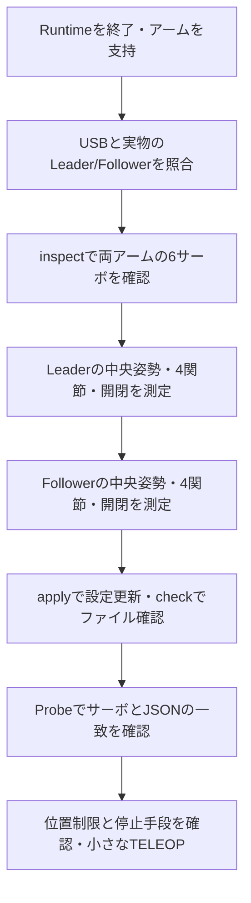

# SO-101のキャリブレーション手順書：準備から動作確認まで

機器や作業の値は、[公開用設定とローカル設定](public_repository.ja.md)に従って `*.local.yaml` へ保存します。手順中のホスト名・パス・USB識別名は例です。

操作端末は統合コンテナのMATE GUIです。ターミナルで `cd /workspace` を実行し、以降のスクリプトとROSコマンドを直接入力します。初回のDocker準備は[環境構築](setup.ja.md)で行います。

**キャリブレーション中は、画面の指示に合わせて人がアームを手で動かします。** プログラムはその位置を読み、原点と可動範囲をサーボとファイルへ保存します。コマンドを実行するだけで、自動的に測定が終わるものではありません。

LeaderとFollowerを別々に測定したあと、2台の測定結果を設定へ反映し、読み取り確認と小さな動作確認へ進みます。使用するのは、このプロジェクトの `scripts/calibrate.sh` です。LeRobotのインストールやコマンド実行は必要ありません。mockでの練習には実機の校正は不要です。

## 校正がROS制御と学習へつながる理由

サーボが返すtickを、そのままROSの角度として扱うことはできません。原点・可動範囲・正方向を対応づけてradへ換算すると、状態、目標、安全制限、学習データに共通の意味を持たせられます。校正を変えると、同じ数値でも実物の姿勢が変わる可能性があります。

この測定はROS Runtimeとは別の対話プログラムで行います。ROSを起動しないのは、同じUSBへ複数のプログラムがアクセスしないようにするためです。測定中は人が動かし、保存後に読み取り確認、さらに小さなROS制御の確認へ進みます。[制御の単位と状態](control.ja.md)も参照できます。

## 目次

- [1. 自分に必要な作業を選ぶ](#choose)
- [2. 用語・関節・コマンドの読み方](#basics)
- [3. Runtimeを止めて作業場所を準備する](#prepare)
- [4. USBポートと実物のアームを照合する](#ports)
- [5. サーボ6台との通信を読み取りで確認する](#inspect)
- [6. Leaderを測定する：画面ごとの操作](#leader)
- [7. Followerを測定する：画面ごとの操作](#follower)
- [8. 測定結果を設定へ反映する](#apply)
- [9. 保存値と実機の一致をProbeで確認する](#probe)
- [10. 小さな動作確認へ進む条件](#acceptance)
- [11. 中止・エラー・復元の方法](#recovery)
- [12. 新品・設定が異なるサーボのIDと通信速度を設定する](#motor-setup)
- [13. LeRobotの手順との対応と違い](#lerobot)
- [14. 保存ファイルと再校正後のデータ収集](#files)
- [15. 校正完了をどう判断するか](#calibration-completion)

<a id="choose"></a>

## 1. 自分に必要な作業を選ぶ

キャリブレーションと、サーボのID設定は別の作業です。**同じSO-101を以前LeRobotで正常に動かしていた場合、IDの付け直しから始める必要は通常ありません。** 今の設定で通信できるかを確認してから、必要な工程を選びます。

| 現在の状態 | 今回行うこと | 飛ばせる工程 |
|---|---|---|
| 同じアームをLeRobotで使い、サーボ・ホーン・組立・原点を変えていない。有効な校正ファイルも確認できる | 手順3〜5で接続確認。`check` と手順9のProbeで設定・サーボの一致を確認し、手順10へ | 新品サーボ設定と再測定。ファイル間の不一致がある場合は手順8も必要 |
| 同じアームだが、既存の校正がどの実機のものか分からない、または測り直したい | 手順3〜10を順番に実施 | 6サーボへ正しく通信できれば、新品サーボ設定は不要 |
| サーボ交換、ホーン付け直し、組立変更をした | 接続・IDを確認して手順3〜10。必要なサーボだけID設定も行う | 変更していないサーボのID再設定 |
| 新品サーボで組み立てる、IDが重複する、通信速度が違う | 手順3〜4で準備し、手順12で1台ずつ設定。その後、手順5〜10 | 校正は省略しない |
| mockでソフトウェアだけ練習する | [mockの操作手順](guide/mock.ja.md)へ | この実機校正手順全体 |

`config/calibration/leader.json` と `follower.json` は、以前の環境から引き継いだ機器固有のファイルです。存在するだけでは、今の実物に合うことは分かりません。Probeの「一致」も保存値同士の一致なので、関節の名前・取り付け方向・姿勢の対応は実物で確認します。

測り直す場合の作業順は次のとおりです。各箱には、コマンド以外に人が行う作業も含みます。



<a id="basics"></a>

## 2. 用語・関節・コマンドの読み方

### 2-1. 2台のアームと6つの関節

Leaderは人が手で操作するアーム、Followerはその操作に追従して物体を扱うアームです。Leaderだけ測ってもFollowerの校正にはなりません。2台の測定値を同じJSONへまとめることもありません。

| 画面に出る関節名 | 日本語での場所・動き | 現在のID | 今回の測定 |
|---|---|---|---|
| `shoulder_pan` | 台座のすぐ上。アーム全体の向きを左右へ振る回転 | 1 | 左右の両端を測る |
| `shoulder_lift` | 肩。台座につながる上腕を持ち上げる／下げる動き | 2 | 肩の上下の両端を測る |
| `elbow_flex` | 肘。上腕と前腕の間を曲げる／伸ばす動き | 3 | 肘の曲げ伸ばしの両端を測る |
| `wrist_flex` | 手首。先端を上下へ折り曲げる動き | 4 | 手首の曲げ伸ばしの両端を測る |
| `wrist_roll` | 手首の先端側。グリッパー／ハンドルの向きをひねる回転 | 5 | 中央姿勢で原点を合わせる。両端の測定画面は出ない |
| `gripper` | Followerは爪の開閉。Leaderは開閉指令を出すハンドル／レバー | 6 | 閉位置と開位置を別々に測る |

Leaderの先端がFollowerの爪と違う形でも、`gripper` は先端の開閉操作を担当する関節です。手首をひねる `wrist_roll` と取り違えないようにします。

IDはサーボの通信上の番号です。同じアームの6台は異なるIDが必要ですが、別のUSBにつながるLeaderとFollowerは、それぞれID 1〜6を使えます。表は現在の `config/hardware/robot.yaml` の設定です。機体のラベルや過去に正常に動いた設定とも照合してください。

### 2-2. 校正で測る数値

| 用語 | 意味 | なぜ必要か |
|---|---|---|
| tick | サーボが返す位置の数値。今回使う1回転の位置範囲は0〜4095 | 機械側の位置をコンピューターが読むため |
| 原点補正／`homing_offset` | 基準姿勢をサーボの数値の中央付近へ移す補正 | 範囲測定中に0と4095の境目をまたぐことを避けるため |
| `range_min` / `range_max` | 手で動かして測った位置の最小／最大 | 関節の位置を角度へ換算するため |
| rad（ラジアン） | Runtimeで使う角度の単位。約0.01745 radが1度 | ROSの関節値と指令を同じ単位で扱うため |
| トルクON/OFF | モーターが力を出す／力を出さない状態 | 校正ではOFFにして人が動かす。OFFでも摩擦や減速機の抵抗は残る |
| Probe | 保存値・位置・通信・カメラを読み取って確認する処理 | 測定結果が実機へ保存されたかを確認するため |

中央姿勢は、各関節を可動範囲の真ん中付近へ置く測定準備の姿勢です。厳密に分度器で角度を測る工程ではありません。後で測った両端の中点が、5つの回転関節のRuntime上の0 radになります。中央姿勢を決めただけで可動範囲の測定が終わるわけではありません。

### 2-3. 入力するターミナルとEnterの意味

この文書のコマンドは、**統合GUI内のターミナル**へ入力します。Runtimeを起動していたターミナルを終了後に使っても、新しく開いても構いません。最初に次を実行します。

```bash
cd /workspace
```

統合GUI内の `calibrate.sh` は、同じコンテナ内で校正プログラムを直接実行します。手動の `docker exec`、ROSの `source`、`so101_ros` の定義は、この校正コマンドには不要です。初めてDockerを準備する場合だけ、先に[環境構築手順](setup.ja.md)を実施します。構築済みなら毎回ビルドしません。

- `bash` のコード欄はコマンド例です。`operator@...$` のようなプロンプトは入力しません。
- `text` の欄は画面表示や対話入力の例です。表示文をコマンドとして貼り付けません。
- 「Enterを押す」は、文字を打たずEnterキーを1回押す意味です。
- 「`yes` と入力」は、小文字で `yes` を打ち、Enterを押す意味です。
- 複数のコマンドは**1つずつ**実行します。測定中の画面へ次のコマンドを貼り付けず、シェルのプロンプトが戻ってから次へ進みます。

校正の既定Profileは `config/runtime/system.real30hz.yaml` です。これはカメラ・記録などの設定をまとめたファイルであり、校正を30 Hzで行うという意味ではありません。今回の原点・可動範囲測定にはカメラを使いません。

別のProfileを使う場合は、`--config` をサブコマンドより前に置きます。

```bash
./scripts/calibrate.sh --config /workspace/config/runtime/system.real30hz.yaml inspect leader
```

GUIの端末と校正プログラムは、どちらも同じ `/workspace` を使います。`cat config/...` はここからの相対パス、`--config /workspace/...` は絶対パスです。

<a id="prepare"></a>

## 3. Runtimeを止めて作業場所を準備する

目的：同じUSBを2つのプログラムが操作することと、トルクOFFでアームが倒れることを防ぎます。

### 3-1. 実行中のプログラムを終了する

Runtimeが起動中で、通常操作できる場合は次の順に終了します。

1. 記録中なら、別の操作ターミナルで記録を閉じます。下の例は失敗として終了する場合です。記録していない場合は実行しません。

   ```bash
   ./scripts/record.sh stop false "キャリブレーションへ移るため終了"
   ```

2. 停止時にアームが落ちないよう支持を確保し、操作ターミナルでIDLEへ戻します。

   ```bash
   ./scripts/mode.sh IDLE
   ```

3. `teleop.sh` のログが流れているRuntimeのターミナルへ戻り、Ctrl+Cを押します。ログの終了を待ち、シェルのプロンプトが戻ったことを確認します。
4. LeRobot、ほかの実機操作プログラム、Probe、学習、テストなども終了します。

Runtimeがすでに終了している場合、`mode.sh IDLE` は不要です。起動していないサービスを呼ぶと `waiting for service...` で待つため、Ctrl+Cで中止します。ESTOP/FAULTを保持している場合も、校正のためにResetする必要はありません。支持を確保してRuntimeをCtrl+Cで終了します。記録が正常に閉じられなかった場合は、その記録を未完了として扱います。

完了の目安：Runtimeのログが終了し、同じ実機を使う別プログラムも終了していること。 Dockerコンテナ自体がRunningのままでも問題ありません。コンテナ起動とRuntime起動は別です。

### 3-2. 固定・支持・作業空間を確認する

| 項目 | 実際に行うこと | 理由 |
|---|---|---|
| 台座 | 机へ固定し、関節を動かしても滑ったり倒れたりしないことを確認 | 台座まで動くと安全に範囲測定できない |
| 支持 | 力を失っても倒れ込まない支持を用意。手で支えるなら挟まれる場所を避ける | 測定開始時・終了時にトルクをOFFにする |
| 空間 | 物体を片付け、手先やアームが机・周囲へ衝突しない空間を作る | 各関節を普段の作業より広く動かすため |
| ケーブル | 動かす範囲で引っ張られないたるみを確保 | ケーブルの張りを関節の端と誤認しないため |
| 給電停止 | モーターへの電源をPCやUSBとは独立に止める方法と操作位置を確認 | 通信できないときも給電を止めるため |

配線を確認する前に、両アームを支持して**モーター電源をOFF**にします。電源を切るときにもアームの重さを支えます。

校正中の通常の中止は、校正ターミナルでCtrl+Cです。`./scripts/estop.sh` はROS Runtime用なので、独立した校正プログラムの停止には使えません。差し迫った危険がある場合は、用意した方法でモーターへの給電を止めます。

<a id="ports"></a>

## 4. USBポートと実物のアームを照合する

目的：Leaderを測るつもりでFollowerへ設定を書き込む取り違えを防ぎます。 ポート名の表示だけでは、どちらの実物につながっているかは分かりません。

### 4-1. 設定値を読む

GUI内のターミナルで実行します。

```bash
cat config/hardware/robot.local.yaml
```

以下は識別名の書式例です。実際の値はローカル設定で確認します。確認対象は `leader:` と `follower:` のそれぞれの `port:` です。

| 対象 | 設定されたUSBポート |
|---|---|
| Leader | `/dev/serial/by-id/usb-YOUR_LEADER_SERIAL` |
| Follower | `/dev/serial/by-id/usb-YOUR_FOLLOWER_SERIAL` |

### 4-2. USBを1本ずつ確認する

Runtimeを終了し、両アームを支持し、モーター電源をOFFにした状態で行います。

1. USBを接続したまま、一覧を表示します。

   ```bash
   ls -l /dev/serial/by-id/
   ```

2. 実物のLeaderからUSBアダプター、PCまでケーブルをたどり、**Leader側のPCにつながるUSBだけ**を外します。
3. もう一度、同じ一覧コマンドを実行します。
4. `YOUR_LEADER_SERIAL` の名前が消えたことを確認します。Followerの識別名が消えた場合は、ケーブルと設定の対応が逆なので整理します。
5. USBを元のアダプターへ戻し、一覧に同じ識別名が戻ることを確認します。
6. Followerについても、USBを外したときに `YOUR_FOLLOWER_SERIAL` が消え、戻すと再表示されることを確認します。
7. ケーブルまたはアダプターにLeader/Followerのラベルを付けます。

機器を交換して識別名が変わった場合は、GUIのエディターで `config/hardware/robot.local.yaml` の該当 `port:` を実際のby-id名へ修正します。関節のIDなど、関係のない値まで変更しません。

`ttyACM0` / `ttyACM1` は再接続で入れ替わることがあります。基準にするのは `usb-...` の識別名です。全USBアダプターを外すと `/dev/serial/by-id/` 自体がなくなることもあります。サーボ同士の電源・通信ケーブルを抜き差しする場合は、必ずモーター電源がOFFの状態で行います。

完了の目安：2本のby-id名と、手元の2台のアームの対応を説明できること。

<a id="inspect"></a>

## 5. サーボ6台との通信を読み取りで確認する

目的：原点を書き換える前に、正しいアームの6サーボと通信できることを確かめます。 USBが一覧に出ることと、サーボが応答することは別です。

### 5-1. 電源を接続する

アームの支持を確保し、USBを戻したことを確認します。対象のモーターに適合する電源の電圧・極性を、電源と機器の表示・資料で確認して給電します。USBだけでサーボの駆動電源も供給されるとは限りません。

この段階では、手で無理に関節を動かしません。`inspect` はトルクを解除する操作ではなく、すでにONのトルクもそのままです。

### 5-2. Leaderを読む

```bash
./scripts/calibrate.sh inspect leader
```

次のような表示が出ます。`...` は省略表示の例であり、入力する文字ではありません。

```text
読み取り対象: leader, port=/dev/serial/by-id/usb-YOUR_LEADER_SERIAL, baudrate=1000000
shoulder_pan: {"configured_id": 1, "id": 1, "baud_code": 0, ...}
shoulder_lift: {"configured_id": 2, "id": 2, "baud_code": 0, ...}
elbow_flex: {"configured_id": 3, "id": 3, "baud_code": 0, ...}
wrist_flex: {"configured_id": 4, "id": 4, "baud_code": 0, ...}
wrist_roll: {"configured_id": 5, "id": 5, "baud_code": 0, ...}
gripper: {"configured_id": 6, "id": 6, "baud_code": 0, ...}
6サーボのID・通信速度を読み取りました。トルク・目標位置・校正値の書き込みは行っていません。
```

| 読む項目 | 意味・判断 |
|---|---|
| `読み取り対象` / `port` | Leaderと、手順4で確認したUSBであること |
| 6つの関節名と最後の成功文 | 6つの設定IDに応答があったこと。途中でエラーになった場合は完了していない |
| `configured_id` と `id` | 設定した番号と読み取った番号。一致が必要 |
| `baudrate=1000000` と `baud_code: 0` | この設定では1 Mbpsで通信。サーボ側のコード0が1 Mbpsを表す |
| `torque_enable` | 0ならOFF。0以外なら力を出している可能性があるため、手で押して動かさない |
| `position_tick` | その時点の位置。以前の校正の影響もあるので、数値だけで校正の正否は分からない |
| `model_number` / `phase` / `operating_mode` | サーボの状態を確認する情報。校正中の設定変更や復旧で使う |

### 5-3. Followerを読む

Leaderのコマンドが終了してシェルへ戻ってから実行します。

```bash
./scripts/calibrate.sh inspect follower
```

`読み取り対象: follower`、FollowerのUSB、6つの関節と最後の成功文を確認します。Leaderが成功していても、Followerは別に確認します。

inspectの関節名は、設定上のIDへ付けた名前です。「ID 3が本当に肘へ取り付けられている」と自動認識する機能はありません。組立時のラベル・記録・以前正常に動いたID割当も確認してください。

通信エラーが出たら、手順11の対応表で電源・配線・ポートなどを確認します。IDの不一致が確認できた場合にだけ、手順12へ進みます。通信できない理由が不明なまま、新品サーボ設定を全台に実行しないでください。

完了の目安：両アームで6サーボの成功文が出て、対象のUSBとID割当を確認できたこと。

<a id="leader"></a>

## 6. Leaderを測定する：画面ごとの操作

再測定する場合に行います。有効な校正をそのまま使う場合は、手順1の再利用経路へ進みます。`measure` は既存ファイルがあっても**新しく測定するコマンド**です。LeRobotにあった「既存ファイルをEnterで再利用／cで再測定」という選択画面はありません。

### 6-1. 測定を起動し、対象を確認する

GUI内のターミナルで1行実行します。

```bash
./scripts/calibrate.sh measure leader
```

画面に次が表示され、入力待ちになります。

```text
対象: leader, port=...YOUR_LEADER_SERIAL, IDs={'shoulder_pan': 1, ...}
電源・支持・停止手段を確認し、このアームを測定する場合 yes を入力:
```

この対象表示は設定ファイルの内容です。実機の通信確認は手順5で済ませておきます。対象がLeaderで、USBとIDが確認した値であり、アームを支持できていることを確認して、次を入力しEnterを押します。

```text
yes
```

`yes` は、この対象へ校正に必要な設定を書き込むことを確認する入力です。測定完了や実機受入完了の意味ではありません。入力前に中止する場合はCtrl+Cで終了でき、この段階ではサーボへ未接続です。

### 6-2. バックアップとトルクOFFを待つ

yes入力後、次の処理が進みます。

1. 既存のJSON・YAMLを `data/calibration/日時-識別子/` へコピーする。
2. サーボへ接続し、現在の原点・位置範囲・Phase・動作モードを読み取り、`leader-servo-before.json` へ保存する。
3. `hardware_qualified` をfalseへ戻す。以前の受入結果で、新しい校正の駆動を許可しないため。
4. トルクをOFFにし、原点・範囲測定に使う位置制御モードと1回転の位置フィードバックを設定する。
5. 中央姿勢を合わせる画面で入力待ちになる。

測定プログラムは目標位置の指令やトルクONを送りません。ただし、設定の書き換えとトルクOFFは行います。自重で動くことがあるため、バックアップ中から支持を続けます。接続後のエラー時にも終了処理でトルクOFFを試みます。

表示されたバックアップ先は、復旧するときに必要です。日時と末尾の識別子をメモしておきます。

### 6-3. 全6関節を中央付近の姿勢へ合わせる

画面表示

```text
全関節を可動範囲の中央付近へ。wrist_rollも中立向き、gripperは中間開度。支持してEnter:
```

ここで初めて、トルクOFFのアームを手で動かして準備姿勢へ合わせます。各関節を、その関節の動く範囲の中央付近へ合わせる操作です。台座を机の中央へ移動する指示ではありません。

| 関節 | 中央姿勢へ合わせるときの考え方 |
|---|---|
| 台座の左右回転 | 左へ振れる端と右へ振れる端の間くらいに置く |
| 肩の上下 | 上げ切った姿勢・下げ切った姿勢のどちらかへ寄せず、その間へ置く |
| 肘の曲げ伸ばし | 折り畳み切った姿勢・伸ばし切った姿勢を避け、その間へ置く |
| 手首の曲げ伸ばし | 上下どちらかへ折り切らず、その間へ置く |
| 手首のひねり | 2台で対応させる基準の向きへ置く。先端の取り付け方向を確認し、ケーブルをねじらない |
| グリッパー／ハンドル | 閉じ切り・開き切りの間くらいの開度へ置く |

姿勢の見た目と動かす場所は、[LeRobot公式のSO-101校正動画](https://huggingface.co/datasets/huggingface/documentation-images/resolve/main/lerobot/calibrate_so101_2.mp4)も参考になります。動画の端末コマンド・Enterの回数はLeRobot用です。この文書のコマンドと画面に従ってください。動画は[公式SO-101資料のCalibrate節](https://huggingface.co/docs/lerobot/en/so101#calibrate)に掲載されたものです。

「肘を必ず90度にする」など、すべての組立に一律の角度は指定しません。支持、組立と取り付け方向、無理なく動く範囲を見て中央付近へ合わせます。トルクOFFでも異常に固い、ケーブルが張る、干渉する場合は無理に動かさず中止します。

全6関節を合わせ、支持した状態で**文字を入力せずEnterを1回**押します。押したあとプログラムは以前の原点・位置範囲をいったんリセットし、現在位置が約2047 tickになる原点補正を書き込みます。以降は、指定された関節の範囲測定です。

### 6-4. `shoulder_pan`：台座の左右回転を測る

画面表示

```text
shoulder_pan: 手で安全な全範囲へゆっくり動かし、測定後Enterを押してください。
shoulder_pan: 現在=....  最小=....  最大=....
```

**この画面が出た時点から、この関節の位置を記録しています。** 開始のためのEnterは不要です。

1. 台座が動かないようにし、アームの重さを支えます。
2. `shoulder_pan` だけをゆっくり左側の無理なく動く端へ動かします。
3. ゆっくり右側の端へ動かします。左右どちらを先にしても構いません。
4. 画面の最小・最大が広がり、両端を測れたことを確認します。
5. 必要なら支持しやすい中央付近へ戻し、**Enterを1回**押してこの関節の測定を終えます。

中央へ戻しても、記録した最小・最大は残ります。端に置いたままEnterを押す必要はありません。最小・最大の数字を入力する操作もありません。

### 6-5. `shoulder_lift`：肩の上下を測る

次に `shoulder_lift` の画面が出ます。

1. 上腕・前腕を支え、台座の左右回転など別の関節が大きく動かないようにします。
2. 肩を動かして上腕を持ち上げる側の端へ、次に下げる側の端へゆっくり動かします。
3. 手先が机や台座へ衝突しないよう、周囲と他の関節の姿勢を確認します。
4. 最小・最大を確認し、支持しやすい姿勢へ戻してEnterを1回押します。

### 6-6. `elbow_flex`：肘の曲げ伸ばしを測る

次に `elbow_flex` の画面が出ます。

1. 肩側を支え、上腕と前腕の間の肘を動かします。
2. 曲げる側の端と伸ばす側の端をゆっくり測ります。可動部へ指を挟まないようにします。
3. 最小・最大を確認し、支持しやすい姿勢へ戻してEnterを1回押します。

### 6-7. `wrist_flex`：手首の曲げ伸ばしを測る

次に `wrist_flex` の画面が出ます。

1. 前腕を支え、先端を上下へ折り曲げる手首の関節を動かします。
2. 手首の両端をゆっくり測ります。先端をひねる `wrist_roll` の動きと取り違えません。
3. 最小・最大を確認し、支持しやすい姿勢へ戻してEnterを1回押します。

これで4つの関節の範囲測定が終わります。現在の設定では上記の順です。`motors` の並びを変更した場合は画面に表示された名前を優先します。

#### 4関節に共通する、端の測り方

「全範囲」は、機体の設計・組立に沿って**無理なく動かせる可動範囲の両端**という意味です。ストッパーへ強く押し付けたり、ケーブルが張っているのに回し続けたりしません。接触点へ押す力で測定幅を増やしません。

プログラムは表示中の1関節だけを測ります。別の関節も一緒に動かした場合、その関節の範囲はまだ記録されていないので、後でその名前が表示されたときに測ります。開始前に動かした範囲も、この測定の代わりにはなりません。

少なくとも2回の読み取りと64 tick以上の測定幅が必要です。幅が4000 tickを超える場合なども拒否します。この数値条件に通るだけで、正しく両端を測れたとは限りません。0付近から4095付近へ大きく飛ぶ表示、動きと数値の不自然な変化があれば、中止して中央姿勢・組立・配線を見直します。

#### `wrist_roll` の範囲画面が出ない理由

この実装は `wrist_roll` を1回転の範囲0〜4095として保存するため、両端を測る画面を出しません。原点補正は手順6-3で行っています。 この扱いは参照したLeRobot実装にもあります。[手順13](#lerobot)に比較を記載しています。

保存範囲が1回転でも、実物をケーブル付きで何回転も回してよいという意味ではありません。取り付け・配線に合わせて、後で `config/hardware/robot.yaml` の使用範囲を制限します。

### 6-8. `gripper`：Leaderの閉位置・開位置を測る

次は、4関節の連続記録と異なり、**Enterを押した瞬間の位置を1回ずつ読む**操作です。

最初の画面

```text
gripperを無理なく閉じた位置に手で合わせてEnter:
```

Leaderのハンドル／レバーを「Followerを閉じる操作に対応させたい端」へ手で合わせます。物体は挟まず、機構へ強く押し付けません。その位置を保ち、Enterを1回押します。これが閉位置として保存されます。

次の画面

```text
gripperを無理なく開いた位置に手で合わせてEnter:
```

ハンドル／レバーを「Followerを開く操作に対応させたい端」へ合わせ、その位置を保ち、Enterを1回押します。これが開位置です。閉じたままもう一度Enterを押すと、幅がなく測定に失敗します。

現在の実装は「閉位置のtick < 開位置のtick」を前提にしています。逆の場合はエラーで停止します。値を手動で並べ替えて成功扱いにせず、ID割当・組立・開閉方向を確認します。自動で反転する機能はありません。

### 6-9. 保存完了を確認する

開位置を確定すると、プログラムは6サーボへ原点・位置範囲を書き込み、読み返して一致を確認します。その後JSONを保存し、終了時にトルクOFFを試みてUSB通信を閉じます。

正常終了の表示

```text
保存しました: /workspace/config/calibration/leader.json
両アームの測定後 ./scripts/calibrate.sh apply を実行してください。
```

シェルのプロンプトが戻ってから、GUIで結果を読めます。

```bash
cat config/calibration/leader.json
```

6つの関節に `id`、`drive_mode`、`homing_offset`、`range_min`、`range_max` があることを確認します。数字はこの実機の測定値です。別のアームや説明用の例の値へ合わせて編集しません。

完了の目安：保存完了文が出てシェルへ戻り、LeaderのJSONが保存されていること。 ここではLeaderだけが測定済みです。まだTELEOPを開始しません。

<a id="follower"></a>

## 7. Followerを測定する：画面ごとの操作

Leaderが終わったあと、**実物のFollowerを支持し直して**測定します。LeaderのJSONをFollowerへコピーする方法ではありません。

### 7-1. Followerの対象表示を確認する

手順5でFollowerの読み取り確認が済み、USB・駆動電源・支持が準備できている状態で実行します。

```bash
./scripts/calibrate.sh measure follower
```

`対象: follower` と、確認した `YOUR_FOLLOWER_SERIAL` のUSB、ID対応を読みます。正しい対象を支持していることを確認し、`yes` と入力してEnterを押します。今回は `follower-servo-before.json` がバックアップに保存されます。

### 7-2. 中央姿勢を合わせる

`全関節を可動範囲の中央付近へ...` の画面が出たら、Followerの台座の左右回転、肩、肘、手首の曲げ、手首のひねり、爪の開度を中央付近へ合わせます。手順6-3の関節別の説明を使って確認します。

特に `wrist_roll` は、Leaderと対応させたい先端の基準方向を確認します。2台を同時に測る必要はありませんが、基準方向の考え方をそろえます。FollowerはLeaderより重く感じることがあるため、力任せに動かしません。

全6関節の準備ができたら、支持した状態でEnterを1回押します。

### 7-3. 表示された4関節を1つずつ測る

| 表示された名前 | 手で行う操作 | 次へ進む操作 |
|---|---|---|
| `shoulder_pan` | 台座の左右回転の両端へゆっくり動かす | 最小・最大を確認してEnterを1回 |
| `shoulder_lift` | 上腕・前腕を支え、肩の上下の両端へ動かす | 最小・最大を確認してEnterを1回 |
| `elbow_flex` | 肩側を支え、肘を曲げる側・伸ばす側の両端へ動かす | 最小・最大を確認してEnterを1回 |
| `wrist_flex` | 前腕を支え、手首の曲げ伸ばしの両端へ動かす | 最小・最大を確認してEnterを1回 |

各画面が出た時点から記録しています。動かす前にEnterを押さず、両端を測ってから押します。支持しやすい姿勢へ戻してから押しても構いません。`wrist_roll` の両端測定画面はFollowerにも出ません。

### 7-4. Followerの爪の閉位置・開位置を測る

1. `gripperを無理なく閉じた位置に...` が出たら、**空の爪**を無理なく閉じ、その位置を保ってEnterを1回押します。対象物を挟んだ位置を閉位置にはしません。
2. `gripperを無理なく開いた位置に...` が出たら、爪を無理なく開き、その位置を保ってEnterを1回押します。
3. サーボへの書き込み・読み返しとJSON保存が終わるまで待ちます。

正常終了の表示

```text
保存しました: /workspace/config/calibration/follower.json
両アームの測定後 ./scripts/calibrate.sh apply を実行してください。
```

シェルへ戻ってから確認します。

```bash
cat config/calibration/follower.json
```

完了の目安：Followerも保存完了文が出て、両アームのJSONがそろっていること。 2台の測定値が違うこと自体は異常ではありません。グリッパーの幅の違いは次の設定反映で対応させます。

<a id="apply"></a>

## 8. 測定結果を設定へ反映する

目的：サーボとJSONに保存した測定値を、Runtimeが使うYAML設定にも反映します。 measureだけではグリッパーの角度・追従倍率の更新まで終わっていません。

### 8-1. 両アームの測定結果を反映する

```bash
./scripts/calibrate.sh apply
```

両JSONを検証し、既存ファイルをバックアップしてから設定を更新します。実機との通信は行いません。測定幅や倍率などが表示され、最後に次が出ます。

```text
JSONからYAMLへ反映しました。Probeと実機受入を行ってください。
```

| 自動で更新する値 | 内容と理由 |
|---|---|
| 両アームの `gripper.open_rad` | 閉位置に測定した開閉幅を加え、角度の全開値を定める |
| Followerの `limits` のmin/max | LeRobot方式では全関節の校正由来の表示・URDF範囲を反映する |
| `config/control/teleop.yaml` の `leader_gripper.scale` | Followerの開閉幅 ÷ Leaderの開閉幅。閉〜全開を対応させる |
| 同じ項目の `offset` | 2台の閉位置の基準差を補正する |
| `hardware_qualified` | false。新しい設定で実機受入を確認するため |

たとえばLeaderの幅が1000 tick、Followerが1500 tickなら倍率は1.5です。同じ開閉操作の割合に対応させるためで、ロボット全体を1.5倍の速度で動かす意味ではありません。

開閉幅の角度換算は `(range_max − range_min) × 2π / 4095`、全開角度は `closed_rad + 開閉幅` です。自分で電卓の値をYAMLへ転記する必要はありません。

### 8-2. ファイル同士の一致を確認する

applyが正常終了したあとに実行します。

```bash
./scripts/calibrate.sh check
```

正常な表示には次が含まれます。JSONの `true` は条件が成立、`false` は成立していないことを表します。

```text
"settings_match": true
"serial_access": false
```

`settings_match: true` はJSONと関連YAMLの整合性を確認できたという意味です。`serial_access: false` は実機に接続せず検査したという意味で、通信エラーではありません。まだサーボ側との一致は検査していません。

### 8-3. 使用する制御方式を確認する

標準の `control_profile: lerobot` では、applyが5つの回転関節の表示用min/maxもJSONから算出します。独自の位置・速度・加速度フィルターは指令へ加えません。`limits` のvelocityとaccelerationは旧 `bounded` 方式でのみ使用します。[LeRobot互換設定](lerobot_compatibility.ja.md)で相違を確認してください。

LeRobot方式のcheckは校正由来の全範囲とTeleop倍率の一致を検査します。手動で狭い運用制限を加える場合は `bounded` 方式へ明示的に切り替え、[実機受入](hardware_acceptance.ja.md)を再確認します。

完了の目安：applyが終了し、反映直後のcheckが成功したこと。

<a id="probe"></a>

## 9. 保存値と実機の一致をProbeで確認する

目的：JSONとYAMLだけでなく、サーボに保存された校正値も一致することを確認します。 Runtimeはまだ起動しません。

### 9-1. 読み取りProbeを実行する

両アームの支持・電源・USBを確認し、同じ機器を使うプログラムが終了している状態で実行します。

```bash
./scripts/probe.sh \
  --config /workspace/config/runtime/system.real30hz.yaml \
  --output /workspace/data/logs/hardware_probe_after_calibration.json
```

Probeは両アームの校正値・現在角度・応答時間・電圧や温度などを読み、3カメラも確認します。サーボの目標位置、トルク設定、校正値は書き込みません。すでにONのトルクを解除する機能もありません。

ファイルへ出力した結果をGUIで読みます。

```bash
cat data/logs/hardware_probe_after_calibration.json
```

### 9-2. どこを見ればよいか

`robots` の一覧には `role: leader` と `role: follower` の2件があります。それぞれ確認します。

| 項目 | この段階で確認する内容 |
|---|---|
| `error` | あれば未完了。表示された通信・設定エラーを解決する |
| `calibration_matches` | 両アームとも `true`。サーボの校正値とJSONが一致している |
| `joint_positions_rad` | 6関節の角度が取得でき、現在の姿勢と不自然な食い違いがない |
| Followerの `inside_configured_limits` | 現在姿勢が `config/hardware/robot.yaml` の位置範囲内なら `true` |
| `torque_enabled` | 各関節のトルク状態。測定直後にONが残っていないか確認 |
| `read_mean_ms` / `read_p95_ms` | 読み取りの平均時間と95%点。標準制御60 Hzでは1周期約16.7 msだが、読み取り以外の処理時間も必要 |
| `cameras` の `error` | カメラ側の失敗。サーボ校正の成否と区別して解決する |

`calibration_matches: false` の場合は、Runtimeを起動して合わせようとせず、保存先・対象アーム・測定完了・復元履歴を確認します。`inside_configured_limits: false` では、現在姿勢が使用範囲外です。トルクOFFであることを確認して支持しながら範囲内の姿勢へ戻すか、実機に合わせて制限を見直し、再度Probeします。

Probeの終了コード0は、通信などの例外がなかったことを表します。校正一致や位置範囲がすべて受入条件を満たしたと自動判定するものではありません。

最低30 Hzで収集したい場合、カメラ設定が30 FPSなだけでは不足です。3台同時の実測FPS・欠損も[Probeの手順](guide/hardware.ja.md#probe)と[実機受入手順](hardware_acceptance.ja.md#recording)で確認します。カメラFPSが不足していても、それだけでサーボを再校正する必要はありません。

完了の目安：両アームの通信・校正一致・現在位置を確認できたこと。

<a id="acceptance"></a>

## 10. 小さな動作確認へ進む条件

ここまでで測定と保存の確認が終わりました。次に、[実機受入手順](hardware_acceptance.ja.md)へ進み、起動前確認を終えてから実機を動かします。

- 関節名・IDと実物の対応を確認できている。
- 2台の校正値が一致し、Followerの現在姿勢が設定範囲内にある。
- 原点・可動範囲と、LeRobot方式の追加フィルターなし・max_relative_target標準nullという指令設定を確認した。
- Followerの駆動電源をPC/ROS/USBとは独立に止める方法を確認した。
- トルクがなくても倒れない支持と、動作中の作業空間を確保した。

この起動前確認を人が終えたあとに、`config/hardware/robot.local.yaml` の `hardware_qualified: true` を設定します。測定・applyが自動でtrueにすることはありません。

実機RuntimeをIDLEで起動し、状態確認後に小さなTELEOPで**各関節の動く方向・姿勢の対応・グリッパー開閉**を確認します。保存値の一致だけでは、取り付け方向や機構の追従は検証できないためです。受入手順の順に進みます。

<a id="recovery"></a>

## 11. 中止・エラー・復元の方法

### 11-1. 通常の中止

校正ターミナルでCtrl+Cを押します。プログラムが動作でき、通信も残っている場合は、トルクOFFのまま元の校正・モードの復元を試みます。JSONは測定とサーボへの読み返しが成功するまで置き換えません。終了後もアームの支持を続けます。

USB断・給電断・強制終了などでは復元やトルクOFFの指令が届かない場合があります。「Ctrl+Cを押したので必ず元通り」とは判断せず、表示とバックアップを確認します。危険がある場合は給電停止を優先します。

### 11-2. 症状ごとの対応

| 画面・症状 | 意味 | 次の操作 |
|---|---|---|
| `waiting for service to become available...` | サービスがない状態でROS操作コマンドを呼んでいる | Ctrl+C。校正はRuntimeなしでcalibrate.shを使う |
| 終了コード75／ロックで終了 | Runtime・学習・Probe・テストなどが共通ロックを使用中 | 該当処理を終了。ロックファイルを削除して回避しない |
| 対話ターミナルが必要／入力が閉じた | TTYがない、パイプやリダイレクトで入力を渡している | GUI内のターミナルでmeasureを直接実行。対話を自動入力しない |
| シリアルポートがない／開けない | ポート名が違う、USB未接続、別プロセスの占有など | 手順4のby-id確認と別プログラムの終了を確認 |
| `Missing motor IDs`／readのtimeout | 対象サーボの応答がない | 駆動電源、配線、USB、ID、通信速度を確認。校正で直そうとしない |
| 範囲が小さすぎる | 指定関節の両端を測る前にEnterを押した可能性 | 復元結果を確認後、そのアームのmeasureを最初からやり直す |
| 原点が境界に近い／範囲が境界を跨ぐ | 中央姿勢や1回転の位置範囲が適切でない可能性 | 手順6-3の中央姿勢と組立を見直して再測定 |
| `gripper: 閉位置 < 開位置...` | 開閉が逆、幅が小さい、同じ位置を2回確定したなど | 先端の関節・ID・方向を確認。JSONのmin/maxを入れ替えない |
| `Gripper SI span must match ...` | JSONの開閉幅とYAMLの角度幅が一致しない | 両JSONを確認し手順8を実施 |
| checkが不一致 | 更新漏れ、または制限を意図的に狭めた | 更新漏れならapply。意図的な制限は手順8-3を確認 |
| ProbeでサーボとJSONが不一致 | 測定・復元・ファイル転用などで保存値が異なる | 対象とバックアップを確認して再測定または明示的な復元 |
| `復元に失敗:` | 元のサーボ値を書き戻せなかった | 通信を復旧し下の手順で復元。受入未完了のまま駆動しない |
| トルクOFF後も関節が異常に固い／干渉する | 摩擦以外の機構・配線の問題がある可能性 | 無理に動かさず中止し、取り付けと配線を確認 |

現在のmeasureには、途中の関節だけを再測定する機能はありません。失敗後の再測定は、対象アームの中央姿勢合わせからやり直します。Tracebackが出た場合は、下部のエラー内容と「復元に失敗」の有無、バックアップ先を確認します。

### 11-3. バックアップから明示的に復元する

自動復元に失敗した場合などに使います。**JSONファイルだけコピーしても、サーボ内部の原点・範囲は戻りません。**

まずGUIで候補を一覧表示します。

```bash
ls -lt data/calibration/
```

次に `ls data/calibration/実際のバックアップ名/` として、復元したい測定の前に保存されたファイルを確認します。「実際のバックアップ名」は、表示された日時と識別子へ置き換えます。単に最新のフォルダーを選ばず、対象アームと測定日時を確認します。

| ファイル | 用途 |
|---|---|
| `0-robot.yaml` / `1-teleop.yaml` | 作業前の設定の確認 |
| `2-leader.json` / `3-follower.json` | 作業前に存在した校正ファイルの確認 |
| `leader-servo-before.json` / `follower-servo-before.json` | サーボ内部から読んだ作業前の値。restoreの入力に使う |

以下はコマンドの形を示す例です。`実際のバックアップ名` を置き換えてから実行します。コンテナ内の `/workspace` パスを使います。

```bash
./scripts/calibrate.sh restore leader \
  --snapshot /workspace/data/calibration/実際のバックアップ名/leader-servo-before.json
```

Followerの場合

```bash
./scripts/calibrate.sh restore follower \
  --snapshot /workspace/data/calibration/実際のバックアップ名/follower-servo-before.json
```

復元対象を確認し、支持・電源・USBを準備してyesを入力します。restoreは値を検証し、トルクOFFで校正・Phase・動作モードを書き戻して読み返し、対象のJSONも復元します。IDと通信速度は復元しません。作業前の校正値が検証条件に合わない場合も停止します。

復元後はapply、check、Probe、実機受入をやり直します。restoreはYAMLの全項目を昔の状態へ戻すコマンドではありません。位置・速度などを手動変更していた場合はバックアップと比較して確認します。`hardware_qualified` はfalseのままです。

<a id="motor-setup"></a>

## 12. 新品・設定が異なるサーボのIDと通信速度を設定する

**必要な場合だけ実施する工程です。** 同じSO-101を以前正常に操作でき、手順5でも6台の通信に成功するなら、ここを実行する必要はありません。

対応対象はSTS3215・Feetech protocol 0です。通信上のID・速度を設定する操作であり、ホーンの取り付け、組立、ファームウェア更新、工場初期化、PID調整は行いません。

### 12-1. 「1台だけ接続」を実物で作る

同じIDの新品サーボを複数つないだままでは、どのサーボを書き換えるかを区別できません。台数は応答だけでは確実に検出できないので、配線を人が確認します。

1. Runtimeと他の操作プログラムを終了し、アームを支持する。
2. モーター電源をOFFにする。
3. 対象のUSBアダプターから設定するサーボ**1台だけ**へ電源・通信ケーブルをつなぐ。
4. そのサーボから別サーボへつながるケーブルも外す。同じバスに他のサーボが残っていないことを確認する。
5. PC側USB、対象1台の配線、適合するモーター電源を確認して給電する。

```text
PC ─ USBアダプター ─ 設定するサーボ1台
                         └ 他サーボへは接続しない
```

使用している基板がWaveshareの対応品の場合は、その基板の資料に従ってUSB通信用ジャンパー設定も確認します。異なる基板へ同じ設定を適用しません。

### 12-2. 現在の値と変更先を区別する

| 指定 | 意味 |
|---|---|
| `leader` / `follower` | 接続先USBと変更先設定を選ぶ |
| `shoulder_pan` などの関節名 | 今つないでいる1台を、どの関節用に設定するか |
| `--current-id` | 書き換える前の、そのサーボの現在のID |
| `--current-baud` | 書き換える前の、そのサーボの現在の通信速度 |
| `config/hardware/robot.yaml`の `motors` / `baudrate` | 変更後のIDと通信速度 |

新品の現在値は購入時の設定・機器資料で確認します。すべての新品をID=1・1 Mbpsと決めつけません。このツールには未知の通信速度を自動探索する機能はありません。現在値が分からない場合は、購入時の情報やサーボ用設定ツールなどで確認してから実行します。

### 12-3. 1台を設定する

次は、現在ID=1、通信速度=1,000,000 bpsと確認できたLeader用shoulder_panの例です。

```bash
./scripts/calibrate.sh setup-motor leader shoulder_pan \
  --current-id 1 --current-baud 1000000
```

画面表示

```text
対象: leader/shoulder_pan: ID 1 -> 1, baud 1000000 -> 1000000
設定対象のサーボ1台だけを接続してください。確認後 ONE を入力:
```

本当に1台だけであることを配線で確認し、**大文字で `ONE` を入力してEnter**を押します。トルクOFFにしてIDと通信速度を書き換え、変更後の設定で読み返します。元から同じ値の場合も読み返して確認します。

正常終了の表示

```text
IDと通信速度を確認しました。全6台の設定・配線後に校正してください。
```

### 12-4. 残りのサーボも1台ずつ設定する

毎回、**コマンド終了 → モーター電源OFF → 1台だけに配線変更 → モーター電源ON → 次の設定コマンド**の順です。通電したままサーボのケーブルを付け替えません。

参照したLeRobotの手順に合わせて先端から行うなら、次の順です。このツールは1回で1台を設定し、次の台への案内を自動で続けるものではありません。

| 順番 | 今回1台だけつなぐ関節 | 設定するID | コマンドの関節名 |
|---|---|---|---|
| 1 | グリッパー／ハンドル | 6 | `gripper` |
| 2 | 手首のひねり | 5 | `wrist_roll` |
| 3 | 手首の曲げ伸ばし | 4 | `wrist_flex` |
| 4 | 肘 | 3 | `elbow_flex` |
| 5 | 肩の上下 | 2 | `shoulder_lift` |
| 6 | 台座の左右回転 | 1 | `shoulder_pan` |

例えば、現在値を確認したLeaderのgripper 1台をつないだ場合は、前のコマンドの `shoulder_pan` を `gripper` へ変えます。Followerのgripperなら次の形です。現在値が違う場合は引数も変更します。

```bash
./scripts/calibrate.sh setup-motor follower gripper \
  --current-id 1 --current-baud 1000000
```

各サーボへ設定済みIDのラベルを付け、2台のアームそれぞれで全6台を確認します。shoulder_panから先に設定しても、各台を1台だけに分け、正しい関節名で実行する条件は同じです。

### 12-5. 全体配線へ戻し、通信確認と校正を行う

1. モーター電源をOFFにする。
2. 設定したIDと実物の関節を確認し、各アームの全6サーボを通常の配線へ戻す。
3. 支持・配線・USBを確認し、適合する電源をONにする。
4. 手順5のinspectをLeader、Followerそれぞれに実行して全6台の応答を確認する。
5. 手順6〜10で原点・可動範囲の測定と設定反映、受入確認を行う。

ID設定の成功は、原点・可動範囲の校正完了を意味しません。途中でIDや通信速度の変更に失敗した場合、変更前の値がまだ使えるとは限らないので、エラーの段階と読み返し結果を確認します。

<a id="lerobot"></a>

## 13. LeRobotの手順との対応と違い

LeRobotを参考にした操作を、このプロジェクトでは別のコマンドと保存先で実装しています。以下は、[LeRobot公式SO-101手順](https://huggingface.co/docs/lerobot/en/so101)と、参照した[Leader校正実装](https://github.com/huggingface/lerobot/blob/22bd7a2f489b367d8df42de803b1e8c4ca63a3f9/src/lerobot/teleoperators/so_leader/so_leader.py)、[Follower校正実装](https://github.com/huggingface/lerobot/blob/22bd7a2f489b367d8df42de803b1e8c4ca63a3f9/src/lerobot/robots/so_follower/so_follower.py)との比較です。LeRobotの今後の変更に追従した完全な互換実装を意味するものではありません。

| 工程 | このプロジェクトで行う方法・違い |
|---|---|
| USBの特定 | USBを外す前後のby-id一覧を比較。ポート発見の専用コマンドは使わない |
| 1台ずつID・通信速度設定 | setup-motorを各台に実行。現在IDと通信速度を明示する |
| 校正前の状態保存 | JSON・YAMLとサーボ内部値をバックアップする |
| 既存校正の再利用 | check・Probe・実物の対応確認を経て再利用。measure中の再利用選択はない |
| トルクOFFと中央姿勢の原点合わせ | measure内にある。人が全6関節を中央付近へ置いてEnter |
| 4つの回転関節の範囲測定 | 各関節に画面があり、関節ごとにEnterで終了。参照実装のまとめた記録画面とは操作が異なる |
| wrist_roll | 中央姿勢で原点を測り、保存範囲は0〜4095。参照実装でも両端測定の対象外 |
| グリッパー | この実装は閉位置と開位置をEnterで個別確定。開閉方向の条件を検査する |
| サーボとファイルへの保存 | サーボへ書いた値を読み返してから、プロジェクトのJSONへ保存 |
| 2台の開閉幅の違い | applyでグリッパー角度とTeleop倍率をYAMLへ反映 |
| 保存後の確認 | Probeで保存値の一致を確認し、小さなTELEOPで方向・姿勢を確認 |

自動化していないこともあります。 物理的な組立の正否、関節へ割り当てたIDの場所、先端の基準方向、機体ごとの安全な使用範囲は、人が実物で確認します。サーボのPID値の手動調整は校正ツールでは行いません。Runtimeの初期化時にはLeRobotと同じFollowerのPID値を設定します。

通常の実機Runtimeは、LeRobotと同じ役割別の動作モード・Follower PID・グリッパー保護設定を行います。校正・読み取り確認・駆動開始は別の操作です。実装は `so101_core/calibration.py`、`feetech.py`、`hardware.py` にあります。通信の参考資料は[Feetech公式通信実装](https://github.com/ftservo/FTServo_Python)です。

ソフトウェアは模擬サーボ・仮想シリアル通信・ROS Runtimeで検証し、接続中の実機では校正と設定値の読み返しを確認しています。LeRobot方式への更新では、トルクOFFでAccelerationだけを254へ合わせ、校正値と目標位置の不変性を確認しました。実物の姿勢・開閉方向・追従の動作確認は、上記の実機作業として行います。

<a id="files"></a>

## 14. 保存ファイルと再校正後のデータ収集

### 14-1. どこに何が保存されるか

| 保存場所 | 内容 | 使用する処理 |
|---|---|---|
| `config/hardware/robot.yaml` | ポート、ID、通信速度、校正ファイルの場所、位置制限、駆動許可 | inspect・measure・Probe・Runtimeなど |
| `config/calibration/leader.json` | Leader固有の原点・位置範囲 | Leaderの位置換算と校正一致確認 |
| `config/calibration/follower.json` | Follower固有の原点・位置範囲 | Followerの位置換算と校正一致確認 |
| `config/control/teleop.yaml` | 関節対応、倍率、オフセット | LeaderからFollowerへの指令換算 |
| `data/calibration/日時-識別子/` | 作業前のファイル、サーボ内部値、測定・反映の記録 | 作業確認・復旧 |
| `data/logs/hardware_probe_after_calibration.json` | 読み取り確認の結果 | 一致・通信・位置・カメラの確認 |

measureはアームごと、applyも別にバックアップフォルダーを作ります。日時はUTC表記で、名前の末尾の `Z` はUTCを表します。日本時間と9時間違うため、表示名の時刻だけで取り違えないようにします。作業前に存在しなかったファイルはバックアップにも入りません。

### 14-2. 校正を変えると以前の記録・モデルも影響を受ける

原点や範囲を変えると、同じ実物の姿勢でも関節の数値が変わる場合があります。**校正と動作確認を確定してから、新しいデータを収集します。** 再校正前のデータを、同じ基準のデータとして新しい記録へ混ぜません。

独自Datasetとモデル情報にはRobot設定と校正JSONのhashを保存し、異なる設定のモデルをそのまま実行しないよう検査します。古いLeRobot形式のDataset・モデルは、このプロジェクトの学習・推論へそのまま入力できません。元MCAPと記録時の設定を確認して独自Datasetへ再変換し、ACTを再学習します。[独自Dataset・学習・推論の手順](data_storage_video.ja.md)を参照してください。

<a id="calibration-completion"></a>

## 15. 校正完了をどう判断するか

サーボのIDと通信速度が正しいこと、原点・範囲を測ったこと、ファイルへ反映したこと、実物で方向と追従を確認したことは別々です。以前LeRobotで使えたという履歴だけで、現在の全工程を完了扱いにはしません。同じ機体を再利用する場合は、手順1の分岐に従って省略できる測定を選びます。

記録に残す内容は、Leader/Followerの識別名、inspectの結果、校正JSONの由来または今回の測定日時、apply/check、Probeの結果、残る受入項目です。ファイル検査の成功を、実機での測定成功と読み替えないようにします。

校正後の[実機受入](hardware_acceptance.ja.md)が済んだら、[テレオペ・収集](guide/teleop.ja.md)で短い記録を確認します。独自のロボットへ応用する場合は、[原点・単位・停止方式の仕様表](custom_robot.ja.md)を作り、SO-101向け校正をそのまま流用できるかを検討します。
