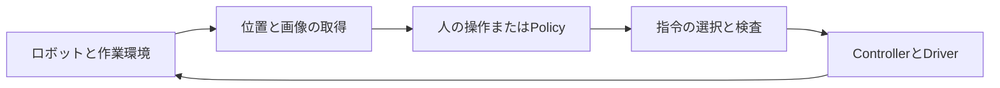

# 1. ロボットが動くまでに何が必要か

[教材の入口](../learning_path.ja.md) ／ [操作の入口](../../README.md)

Leaderを動かすとFollowerが追いかけます。画面にはカメラの映像が出て、記録開始のキーを押すとファイルが増えます。この一連の動作には、モーターの読み取り、目標の計算、通信、停止の監視、画像の取得、ファイルへの保存が関わっています。

別のロボットを作るときは、この処理の分担から考えます。SO-101と同じソフトウェアを使える部分もあれば、電源やモーターの仕様に合わせて作り直す部分もあるためです。

## 観測と指令を往復させる

ロボットが実際に取っている状態をstate、これから与える指令をactionと呼びます。このプロジェクトのstateは主に関節の位置で、actionは各関節の絶対目標位置です。画像も含めて判断に使う情報をobservation、観測から指令を決める処理をpolicyと呼びます。

例えば、現在角度が0.2 radの関節へ0.5 radを指令したとします。送信に成功した直後でも、関節はまだ0.2 rad付近にあるかもしれません。モーターが回るには時間がかかり、物体との接触や重さによって追従も変わります。目標と実測を別々に記録すれば、この差を調べられます。

動かした結果を再び測る構成が閉ループです。SO-101のサーボ内部にも、目標とエンコーダの値を比較して駆動する制御があります。その外側では、ROSの処理が状態の更新や指令の期限を確認し、AIが新しい観測から次の動作を予測します。制御の速さと責任は、それぞれの処理で異なります。

本プロジェクトでは、人が目標を作るときもAIが作るときも、同じSafetyとControllerを通します。そうすると、操作方法を切り替えても通信異常や古い指令の扱いを共通にできます。モデルの中へモーター通信や停止の処理を埋め込む必要もありません。

## Physical AIの学習で記録するもの

消しゴムをつかむ直前の画像だけを保存しても、次にどの関節をどちらへ動かしたかは分かりません。模倣学習では画像・関節状態と、人が操作したときの指令を対応付けて保存します。学習するのは、観測から指令へ変換する規則です。

この対応には時間も含まれます。つかむ前の画像へ、すでに持ち上げた後の指令を割り当てると、誤った組を正解として与えてしまいます。撮影、計測、指令生成、保存の時刻を区別する理由がここにあります。

作業1回分の記録をEpisodeと呼びます。同じ作業を繰り返して集めたEpisodeからDatasetを作り、モデルを学習します。学習した重みや設定を保存したものがCheckpointです。実行時には、そのモデルと学習時の関節順・単位・前処理が合っているかを確認します。

現在のモデルは画像と関節位置から動作列を予測する単一タスクのモデルです。作業名の文字列を変えるだけで、別の作業を理解する機能はありません。ACTとflowモデル、RTC系の処理、A2C2の補正を、同じロボットの実行基盤へ接続しています。

## 操作用PCとLinuxホストとコンテナの関係

操作用PCでFoxgloveを開いていても、サーボのUSB通信と記録処理はLinuxホストで動きます。操作用PCは映像や診断を受け取り、作業を見ている端末です。操作用PCへの表示が切れたときも、Linuxホストの処理が終了したとは限りません。

| 場所 | 担当するもの | 保存されるもの |
|---|---|---|
| Linuxホスト | 物理USB、GPU、Dockerの起動 | プロジェクトと収集データ |
| 統合コンテナ | ROS 2、GUI、制御、記録、学習 | `/workspace` を通じてホストと共有 |
| 操作用PC | SSH接続、ブラウザ、Foxgloveの表示 | 自分で取得したレイアウトなど |

コンテナはROSやPythonライブラリーをまとめた実行環境です。カメラそのものやGPUドライバーがコンテナの中に複製されるわけではありません。ホストの機器へアクセスできるよう、起動時のCompose設定でデバイスや権限を渡します。

ホストのプロジェクトはコンテナ内では `/workspace` に見えます。例えば `/workspace/data/bags/` に保存した記録はホストのプロジェクト直下の `data/bags/` と同じファイルです。画面を閉じたりコンテナを作り直したりすることと、共有ファイルを削除することは別の操作になります。

## ビルドと起動を分ける

Dockerイメージをビルドすると、OSやROS、ライブラリーをそろえた環境ができます。ROSワークスペースをビルドすると、このプロジェクトのC++コードや独自メッセージをROSから利用できる形へ準備します。どちらもロボットを操作するRuntimeの起動とは別です。

| 操作 | 変わるもの | 必要になる場面 |
|---|---|---|
| `gui.sh build` | コンテナ用のイメージ | Dockerfileや導入ライブラリーの変更 |
| `build.sh` | ROSの成果物とパッケージ登録 | 初回の共有Workspace、C++・メッセージなどの変更 |
| `teleop.sh`、`collect.sh`、`deploy_policy.sh` | 実行中のプロセス | 実際の操作・収集・モデル実行 |

ビルド後の `source .../install/setup.bash` はパッケージの場所を端末へ知らせる操作です。新しいコードをコンパイルする処理でも、Runtimeを再起動する処理でもありません。準備した同じコードを普段使うときは、毎回のビルドを省けます。

## 動くことと理解できたことを確かめる

「関節位置を読めた」「目標を送れた」「目標どおりに動いた」は、それぞれ別の確認です。USBが見つかってもサーボが応答しない場合があり、通信が成功しても校正や方向が違う場合があります。mockでは通信するプログラムのつながりを確かめ、実機では測定値と物理的な動きの対応を確認します。

自分の構成図に、観測、指令生成、指令検査、駆動、記録の担当を書き込めれば、機体を替えるときの相談事項も具体的になります。モーターを替えたならDriverと校正、カメラを替えたなら取得方式と時刻、位置指令をトルク指令へ替えたならControllerと停止の設計が見直しの対象です。

操作は[環境構築](../setup.ja.md)と[mock練習](../guide/mock.ja.md)、構成の実装は[RuntimeのLaunch](../../ros2_ws/src/so101_bringup/launch/runtime.launch.py)で確認できます。

[次の教材：ROS 2で処理をつなぐ](02-ros-communication.ja.md)
